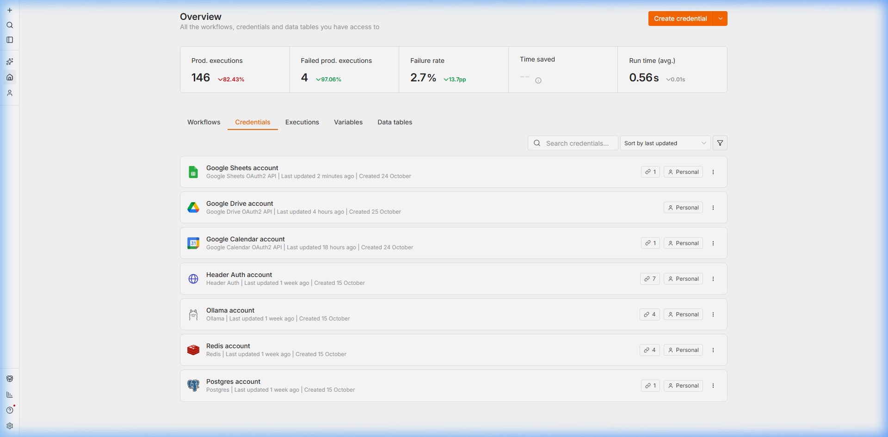
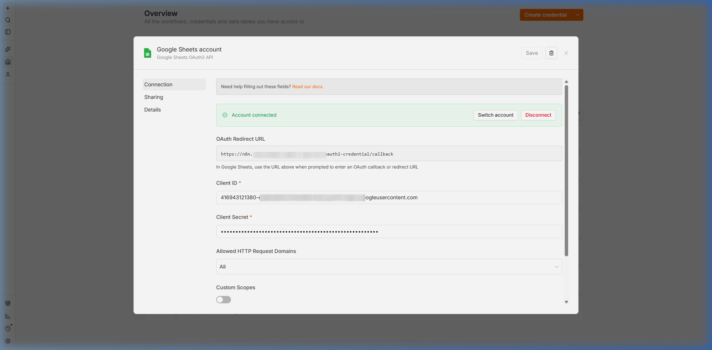
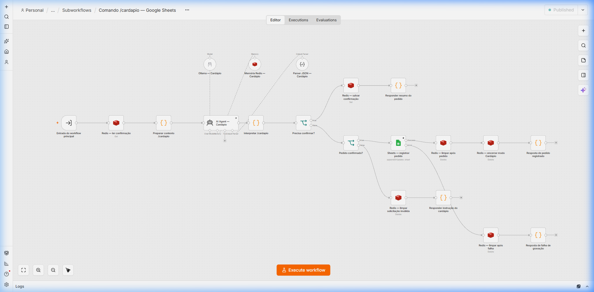
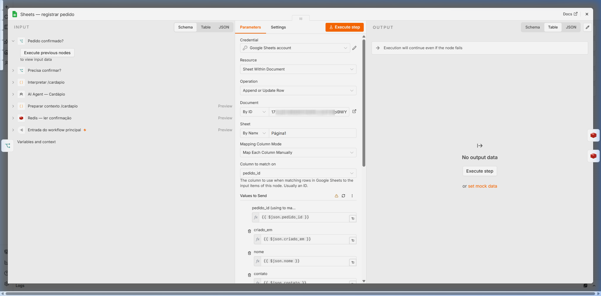
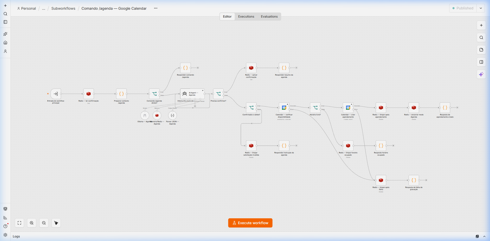
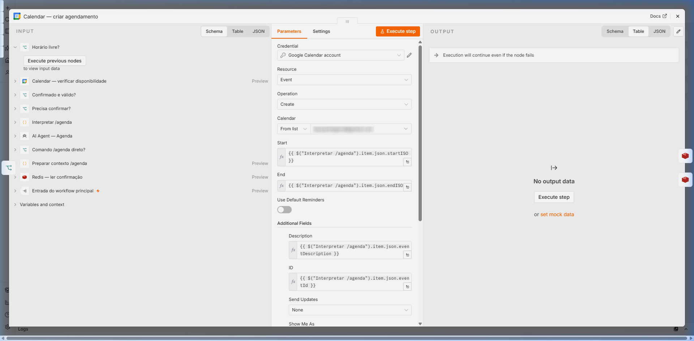

# Guia ilustrado — conexão com Google Sheets, Calendar e Drive

**Projeto:** n8n self-hosted em Docker Compose  
**Integração:** Google Cloud Platform (OAuth 2.0)  
**Serviços:** Google Sheets API, Google Calendar API, Google Drive API  
**Workflows atendidos:** `/cardapio` (Google Sheets) e `/agenda` (Google Calendar)  
**Revisado:** 25/10/2026

> **Sobre os prints:** as imagens abaixo são capturas e referências visuais da interface do Google Cloud Console e do editor n8n configuradas para o projeto. Elas mostram os formulários, escopos e telas de consentimento exigidos para autenticar as aplicações sem expor senhas.

---

## O que esta integração faz

As automações de atendimento da Fatec Bebedouro utilizam o n8n para interagir diretamente com ferramentas de produtividade da Google via OAuth 2.0:
1. **Google Sheets (`/cardapio`)**: Grava pedidos confirmados pelos clientes em uma planilha centralizada para controle de pedidos.
2. **Google Calendar (`/agenda`)**: Verifica em tempo real a disponibilidade de horários e cria eventos privados de 30 minutos na agenda da secretaria/coordenação.
3. **Google Drive**: Gerencia permissões e uploads de documentos ou anexos quando necessário.

O fluxo de dados seguro opera assim:
`WhatsApp → Chatwoot → n8n → Token OAuth 2.0 → Google API (Sheets / Calendar) → Confirmação`

---

## 1. Crie o projeto e ative as APIs no Google Cloud Console

1. Entre no [Google Cloud Console](https://console.cloud.google.com/) com a sua conta Google administrativa.
2. No topo da barra superior, clique no seletor de projetos e selecione **Novo Projeto**.
3. Defina o nome do projeto (ex.: `Fatec-Chatbot-n8n`) e clique em **Criar**.
4. No menu lateral, acesse **APIs e Serviços → Biblioteca** (Library).
5. Pesquise e clique em **Ativar** (Enable) para cada uma das três APIs:
   - **Google Sheets API**
   - **Google Calendar API**
   - **Google Drive API**

---

## 2. Configure a tela de permissão OAuth (OAuth Consent Screen)

1. No menu lateral, abra **APIs e Serviços → Tela de permissão OAuth**.
2. Selecione o tipo de usuário **Externo** (External) e clique em **Criar**.
3. Preencha as informações básicas do aplicativo:

| Campo no GCP | Valor do projeto |
|---|---|
| **Nome do app** | `Fatec Bot n8n` |
| **E-mail para suporte do usuário** | Seu e-mail de administrador |
| **Dados de contato do desenvolvedor** | Seu e-mail de administrador |

4. Na aba **Escopos** (Scopes), clique em **Adicionar ou remover escopos** e selecione:
   - `.../auth/spreadsheets` *(Google Sheets)*
   - `.../auth/calendar` e `.../auth/calendar.events` *(Google Calendar)*
   - `.../auth/drive` ou `.../auth/drive.file` *(Google Drive)*
5. Na aba **Usuários de teste** (Test Users):
   - Como o aplicativo estará em modo de homologação/desenvolvimento, adicione os e-mails das contas que farão login no n8n (ex: `seu-email@gmail.com`).

---

## 3. Crie as credenciais OAuth 2.0 (Client ID) no Google Cloud

1. No menu lateral do GCP, acesse **APIs e Serviços → Credenciais**.
2. Clique em **+ Criar Credenciais → ID do cliente OAuth**.
3. Configure o formulário com os seguintes parâmetros:

| Campo no GCP | Valor da configuração |
|---|---|
| **Tipo de aplicativo** | `Aplicativo da Web` (Web application) |
| **Nome** | `n8n OAuth Credentials` |
| **URIs de redirecionamento autorizados** | `https://n8n.fatecn8nabc.dpdns.org/rest/oauth2-credential/callback` *(ou `http://localhost:5678/rest/oauth2-credential/callback` em teste local)* |

4. Clique em **Criar**. Copie o **Client ID** e o **Client Secret**.

---

## 4. Cadastre e autorize a credencial no n8n

1. Acesse o painel do seu n8n e abra a aba **Credentials**.
2. Todas as integrações com os serviços Google e banco de dados ficam catalogadas e ativas:

> **Print 1 — Lista de credenciais ativas no n8n.** Visão geral do painel contendo as credenciais autenticadas de Google Sheets API, Google Drive API e Google Calendar API ao lado dos conectores de infraestrutura (Redis, Postgres, Ollama).

3. Clique em **Add Credential** ou abra a credencial **Google Sheets account** / **Google Calendar account**:
4. Preencha o **Client ID** e o **Client Secret** obtidos no GCP.
5. Clique no botão **Sign in with Google** (ou "Connect my account") para concluir o fluxo OAuth 2.0.
6. Após conceder permissão, o n8n confirmará o vínculo com a etiqueta verde **Account connected**:

> **Print 2 — Modal de autorização OAuth 2.0 no n8n.** Client ID de produção configurado, callback do Cloudflare Tunnel registrado e status verificado com sucesso ("Account connected").

---

## 5. Vincule a credencial aos nós dos workflows

### 5.1. Workflow `/cardapio` (`Comando /cardapio — Google Sheets.json`)

O subworkflow processa as solicitações de pedidos vindas do Chatwoot, gerencia a confirmação com o cliente via Redis e grava a linha final na planilha Google Sheets:

> **Print 3 — Visão geral do workflow /cardapio no canvas do n8n.** Recepção do payload, agente de extração de itens, chave de confirmação no Redis e gravação final na planilha.

No nó **`Sheets — registrar pedido`**:
- **Credential**: Selecione `Google Sheets account`.
- **Resource**: `Sheet Within Document`
- **Operation**: `Append or Update Row`
- **Document ID**: `<ID_DA_SUA_PLANILHA>` (`Pedidos - Cardápio (n8n)`)
- **Sheet Name**: `Página1`
- **Columns to Match**: `pedido_id`
- **Fields**: `pedido_id`, `criado_em`, `nome`, `contato`, `itens`, `observacoes`, `status`

> **Print 4 — Parametrização do nó Sheets — registrar pedido.** Vinculação da credencial Google Sheets autorizada, chave de correspondência `pedido_id` e mapeamento das colunas da planilha.

---

### 5.2. Workflow `/agenda` (`Comando /agenda — Google Calendar.json`)

O subworkflow `/agenda` interpreta datas e horários em linguagem natural, verifica a disponibilidade de agenda na Google Calendar API e cria o evento confirmado:

> **Print 5 — Visão geral do workflow /agenda no canvas do n8n.** Análise semântica da data/hora com IA, checagem de conflitos no Google Calendar, confirmação no Redis e criação do evento privado.

No nó **`Calendar — criar agendamento`**:
- **Credential**: Selecione `Google Calendar account`.
- **Resource**: `Event`
- **Operation**: `Create`
- **Calendar**: `seu-email@gmail.com`
- **Start**: `={{ $("Interpretar /agenda").item.json.startISO }}`
- **End**: `={{ $("Interpretar /agenda").item.json.endISO }}`
- **Description**: `={{ $("Interpretar /agenda").item.json.eventDescription }}`
- **Visibility**: `private` (compromisso particular)

> **Print 6 — Parametrização do nó Calendar — criar agendamento.** Configuração do nó no n8n com a credencial Google Calendar, agenda de destino e variáveis dinâmicas de início e término.

---

## 6. Diagnóstico e Resolução de Problemas

| Sintoma | Causa mais provável | O que fazer |
|---|---|---|
| **Erro `redirect_uri_mismatch` (400)** | URL de callback divergente entre GCP e n8n. | Confira a URL informada na credencial do n8n e cole-a exatamente igual no GCP (atenção a `https://`, subdomínio e ausência de barra no final). |
| **Erro `access_denied` ao logar** | A conta Google não foi inserida como usuário de teste. | No GCP, acesse **Tela de permissão OAuth → Usuários de teste** e adicione o e-mail que está tentando autenticar. |
| **Token expirando a cada 7 dias** | O app no GCP permanece com status "Em teste". | Na **Tela de permissão OAuth**, clique em **Publicar aplicativo** (Publish App). Em modo de produção, os tokens de atualização têm duração indeterminada. |
| **Erro 403 (Permission Denied)** | A conta autenticada não possui acesso à planilha. | Abra a planilha no Google Sheets e compartilhe-a como "Editor" com a conta Google conectada no n8n. |

---

## 7. Checklist antes de encerrar

- [ ] APIs ativadas: Google Sheets API, Google Calendar API e Google Drive API.
- [ ] Escopos adicionados: `spreadsheets`, `calendar`, `calendar.events` e `drive`.
- [ ] Usuário de teste cadastrado na tela de consentimento.
- [ ] URI de redirecionamento autorizada cadastrada com a rota `/rest/oauth2-credential/callback`.
- [ ] Credencial testada no n8n com status verde (**Connection tested successfully**).
- [ ] Planilha compartilhada com permissão de edição.
- [ ] Nós `Sheets — registrar pedido`, `Calendar — verificar disponibilidade` e `Calendar — criar agendamento` salvos com a credencial vinculada.
- [ ] Nenhuma chave secreta ou token gravado diretamente no corpo dos workflows exportados.

---

## 8. Fontes e documentações oficiais

- [Google Cloud Console — Autenticação OAuth 2.0](https://developers.google.com/identity/protocols/oauth2): documentação oficial do fluxo web server.
- [Documentação Oficial do n8n — Google Sheets](https://docs.n8n.io/integrations/builtin/app-nodes/n8n-nodes-base.googlesheets/): guia de configuração de credenciais OAuth2.
- [Documentação Oficial do n8n — Google Calendar](https://docs.n8n.io/integrations/builtin/app-nodes/n8n-nodes-base.googlecalendar/): operações de disponibilidade e agendamento.
