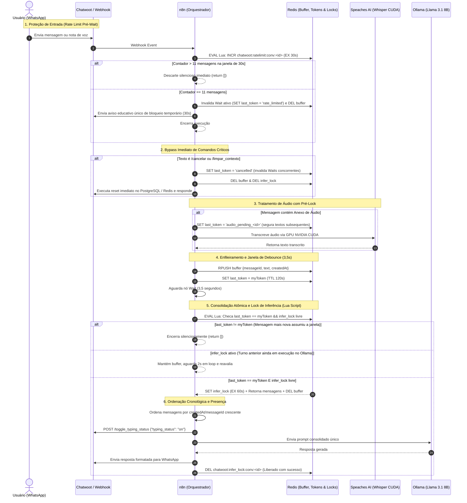

# Relatório Técnico: Ajustes de Concorrência, Rate Limit e Operação Atual do Assistente Virtual

> **Projeto de TCC:** Plataforma de Assistente Virtual Multimodal — Fatec Bebedouro  
> **Autor:** Gabriel Bassani da Silva (Curso Superior de Tecnologia em Big Data no Agronegócio)  
> **Orientação:** Fatec Bebedouro — Jorge Caram Sabbag  
> **Data:** Outubro de 2026  
> **Branch de Desenvolvimento:** `feat/knowledge-base-and-workflows`  
> **Stack:** Docker Compose | WAHA (WhatsApp Gateway) | Chatwoot (Omnichannel) | n8n (Orquestrador) | Redis (Buffers & Locks) | PostgreSQL (PGVector HNSW) | Speaches AI (faster-whisper CUDA) | Ollama (Llama 3.1 8B & Qwen3-Embedding)

---

## 1. Visão Geral do Projeto e Arquitetura

O projeto consiste em um ecossistema completo de inteligência artificial conversacional e multimodal, projetado para operar **100% em infraestrutura local** (sem custos de nuvens de terceiros ou envio de dados acadêmicos confidenciais para APIs externas).

### Topologia de Serviços (Docker Compose)

```text
                               ┌────────────────────────────────────────────────────────┐
                               │                    DOCKER COMPOSE                      │
                               │                                                        │
[WhatsApp / Aluno]             │   ┌─────────────┐       ┌───────────────┐              │
        │                      │   │    WAHA     │──────▶│   Chatwoot    │              │
        │                      │   │  (Gateway)  │       │ (Omnichannel) │              │
        │                      │   └─────────────┘       └───────┬───────┘              │
        ▼                      │                                 │ Webhook              │
┌────────────────┐             │                                 ▼                      │
│ Entrada do     │─────────────┼─────────────────────────▶┌─────────────┐              │
│ Aluno (Texto/  │             │                          │     n8n     │              │
│ Voz WhatsApp)  │             │                          │(Orquestrador│              │
└────────────────┘             │                          └──────┬──────┘              │
                               │                                 │                      │
                               │          ┌──────────────────────┼──────────────────┐   │
                               │          ▼                      ▼                  ▼   │
                               │   ┌─────────────┐        ┌─────────────┐     ┌─────────┴──┐
                               │   │    Redis    │        │ Speaches AI │     │   Ollama   │
                               │   │(Buffer/Locks│        │ (GPU Whisper│     │(Llama 3.1/ │
                               │   │ Tokens/Rate)│        │   CUDA)     │     │ Embeddings)│
                               │   └─────────────┘        └─────────────┘     └─────────┬──┘
                               │                                                        │
                               │                                 ┌──────────────────────┘
                               │                                 ▼
                               │                          ┌─────────────┐
                               │                          │ PostgreSQL  │
                               │                          │  (PGVector  │
                               │                          │  HNSW + DB) │
                               │                          └─────────────┘
                               └────────────────────────────────────────────────────────┘
```

---

## 2. Diagnóstico das Falhas Corrigidas

Antes da refatoração, o pipeline de ingestão e agrupamento do webhook continha vulnerabilidades críticas de concorrência e escalabilidade:

| Vulnerabilidade / Falha Anterior | Causa Técnica Raiz | Impacto no Sistema | Solução Implementada em Produção |
| :--- | :--- | :--- | :--- |
| **Gargalo de I/O em Disco no Debounce** | O buffer de agrupamento gravava e deletava mensagens temporárias na tabela `fatec_message_buffer` do PostgreSQL. | Operações de disco concorrentes desnecessárias degradando o pool de conexões do banco relacional. | **Migração Total para Redis:** Uso da chave `chatwoot:buffer:conv:<id>` em RAM com TTL de 120s, eliminando 100% do I/O de disco no buffer. |
| **Race Condition no Dreno do Buffer** | Existia um intervalo não atômico entre a consulta (`LRANGE` ou `SELECT`) e a exclusão (`DEL` ou `DELETE`). | Mensagens concorrentes que chegavam durante o processamento eram apagadas antes de serem respondidas. | **Script Atômico em Lua (`EVAL`):** Verificação de token, aquisição de lock, dreno das mensagens e deleção do buffer executados em uma única instrução atômica no Redis. |
| **Inundação de Nós `Wait` (Flooding / Spam)** | Mensagens repetidas ou disparadas em massa alocavam instâncias do nó `Wait` (3,5s) na memória do n8n antes de qualquer filtragem. | Risco de exaustão de memória da VM e colapso do orquestrador n8n por excesso de instâncias `Wait` ativas. | **Rate Limit Atômico Pré-Wait:** Script Lua `INCR` + `EXPIRE 30` no início do fluxo. A partir da 12ª mensagem em 30s, o descarte é silencioso e instantâneo (`return []`), sem alocar instâncias de `Wait`. |
| **Latência Injustificada em Comandos Críticos** | Comandos como `/cancelar` e `/limpar_contexto` precisavam aguardar a janela de 3,5s do `Wait`. | Experiência travada para o usuário ao tentar abortar um pedido ou resetar a conversa. | **Bypass Imediato:** Roteamento prioritário logo após a normalização que invalida qualquer `Wait` ativo (`last_token = 'cancelled'`), deleta buffers/locks e limpa o contexto em **1,3s**. |
| **Race Condition: Áudio Longo vs Texto Rápido** | Áudios que demoravam 3 a 6s para transcrever no Speaches AI eram atropelados por textos curtos enviados 0,5s depois (*"escuta aí"*), pois o texto completava o `Wait` de 3,5s antes do áudio sair do Speaches. | O texto acordava, encontrava `last_token == myToken` e disparava o Ollama ignorando o áudio que ainda estava sendo transcrito. | **Contador Atômico `audio_pending`:** `INCR` atômico antes do Speaches AI e checagem no Lua (`KEYS[4]`). Se `audio_pending > 0`, retorna `0` e segura o texto no loop até a transcrição do áudio entrar no buffer. |
| **Colisão Concorrente de Turnos na GPU** | Uma nova mensagem enviada enquanto o Ollama ainda gerava uma resposta concorria pela GPU NVIDIA. | Degradação severa de VRAM, latência estendida e respostas corrompidas. | **Lock Atômico de Inferência (`infer_lock`):** A nova mensagem aguarda no buffer em loop de 2s até a inferência anterior terminar. Assim que a GPU libera, o lock é assumido e o novo turno é processado sequencialmente. |
| **Ausência de Feedback Visual** | O aluno enviava a mensagem e ficava sem retorno durante o processamento do LLM local. | Sensação de lentidão ou travamento no WhatsApp. | **Sinalização de Presença (`typing_on`):** O n8n envia `POST /toggle_typing_status` para a API do Chatwoot antes de chamar o LLM, exibindo "digitando..." no WhatsApp do aluno. |
| **Perda de Contexto no `Error Trigger`** | Em exceções não tratadas, o nó `Error Trigger` do n8n não preserva o `$json.conversationId` das etapas anteriores. | Tentava deletar `conv:undefined` e deixava a conversa travada pelo lock de inferência até o TTL passivo de 60s expirar. | **Desbloqueio por `execution.id`:** Script Lua que varre as chaves `chatwoot:infer_lock:conv:*` identificando qual conversa pertence à `_${failedExecId}`, limpando `infer_lock` e `audio_pending` atomicamente. |

---

## 3. Diagrama de Sequência da Nova Arquitetura

O ciclo completo de processamento de mensagens, proteção de entrada e inferência atômica está documentado abaixo:



---

## 4. Implementação Detalhada dos 10 Novos Nós no n8n

### A. Prevenção de Rate Limit Pré-Wait (`Redis — Rate Limit Check`)
- **Tipo:** `n8n-nodes-base.code`
- **Operação:** Script Lua atômico que incrementa o contador e define TTL de 30s no primeiro evento.
- **Regra de Negócio:**
  - `count <= 10`: Prossegue normalmente para o buffer.
  - `count == 11`: Sobrescreve `last_token` com `'rate_limited'`, limpa o buffer ativo no Redis, dispara o aviso educativo e encerra.
  - `count > 11`: Retorna array vazio (`return []`), descartando instantaneamente a execução sem alocar memória nem nós `Wait`.

### B. Decisão de Rate Limit (`Rate Limit Excedido?`)
- **Tipo:** `n8n-nodes-base.if`
- **Condição:** `$json.isRateLimited === true`.
- **Roteamento:** 
  - `true`: Conecta diretamente ao nó de formatação e envio ao Chatwoot, encerrando a execução.
  - `false`: Segue para o enfileiramento no buffer.

### C. Bypass Imediato (`Redis — Resetar Locks e Invalidar Buffer`)
- **Tipo:** `n8n-nodes-base.code`
- **Gatilho:** Regex `/cancelar|/limpar_contexto|/limpar|/reset|/reiniciar` no nó de validação.
- **Ação Atômica:** Executa pipeline Redis definindo `chatwoot:last_token:conv:<id> = 'cancelled'` e deletando `buffer` e `infer_lock`. Segue direto para a rotina de reset de sessão sem passar pelo nó `Wait`.

### D. Pré-Lock de Áudio (`Redis — Marcar Áudio Pendente`)
- **Tipo:** `n8n-nodes-base.code`
- **Posicionamento:** Rota 1 do `Roteador de tipo de mensagem`, antes do download e transcrição no Speaches AI.
- **Ação:** Define `chatwoot:last_token:conv:<id> = 'audio_pending_<id>'` (TTL 120s), segurando qualquer texto curto subsequente até a transcrição terminar.

### E. Enfileiramento com Metadados (`Redis — Salvar Mensagem no Buffer`)
- **Tipo:** `n8n-nodes-base.code`
- **Payload do `RPUSH`:** `{ messageId: Number, text: String, createdAt: Number }`.
- **Token Unívoco:** Salva `myToken = ${messageId}_${$execution.id}` na chave `chatwoot:last_token:conv:<id>`.

### F. Janela de Agrupamento (`Aguardar janela de digitação`)
- **Tipo:** `n8n-nodes-base.wait`
- **Duração:** 3,5 segundos (tempo médio de digitação contínua em WhatsApp).

### G. Consolidação Atômica & Loop de Lock (`Redis — Consolidar Buffer e Lock de Inferência`)
- **Tipo:** `n8n-nodes-base.code`
- **Script Lua `EVAL`:**
  ```lua
  local last_token = redis.call('GET', KEYS[1])
  if last_token ~= ARGV[1] then
    return { -1, {} }
  end
  local lock = redis.call('GET', KEYS[2])
  if lock and lock ~= '' then
    return { 0, {} }
  end
  redis.call('SET', KEYS[2], ARGV[1], 'EX', 60)
  local msgs = redis.call('LRANGE', KEYS[3], 0, -1)
  redis.call('DEL', KEYS[3])
  return { 1, msgs }
  ```
- **Loop Assíncrono:** Se `status == 0` (lock ocupado), realiza pausa assíncrona de 2s e retenta até 15 vezes (30s de janela máxima de segurança).
- **Ordenação Cronológica Crescente:** Faz `sort` do array por `createdAt` e `messageId`, unindo o texto consolidado por `\n`.

### H. Sinalização de Digitação (`Chatwoot — Ativar Digitando`)
- **Tipo:** `n8n-nodes-base.httpRequest`
- **Endpoint:** `POST http://chatwoot-web:3000/api/v1/accounts/1/conversations/{convId}/toggle_typing_status`
- **Payload:** `{"typing_status": "on"}`
- **Opção de Resiliência:** `continueRegularOutput: true` (falha na API do Chatwoot nunca bloqueia a resposta do aluno).

### I. Liberação do Lock de Inferência Pós-Envio (`Redis — Liberar Lock de Inferência`)
- **Tipo:** `n8n-nodes-base.code`
- **Posicionamento:** Conectado imediatamente após o nó `Enviar resposta ao Chatwoot`.
- **Ação:** Executa `DEL chatwoot:infer_lock:conv:<id>`, liberando a GPU imediatamente para mensagens subsequentes.

### J. Recuperação contra Falhas (`Error Trigger` & `Redis — Liberar Lock no Erro`)
- **Tipo:** `n8n-nodes-base.errorTrigger` + `n8n-nodes-base.code`
- **Ação:** Garante que mesmo em caso de falha não tratada em qualquer nó do workflow, o lock da conversa seja removido, complementado pelo TTL passivo de 60s.

---

## 5. Como o Projeto Está Operando Agora (Modos e Funcionalidades)

### Modos Operacionais do Assistente:

1. **🏛️ Modo Institucional Acadêmico (`/fatec`):**
   - Modo padrão de recepção do aluno.
   - Conectado à base de conhecimento vetorial no PostgreSQL via índice **HNSW**.
   - Responde com autoridade e concisão sobre vestibulares, cursos (Logística e Big Data no Agronegócio), regulamento de estágio supervisionado, manual de TCC, contatos da secretaria e explicações detalhadas sobre o TCC de Gabriel Bassani.
   - Não inventa informações externas e mantém tom humanizado sem jargões de inteligência artificial.

2. **🍔 Modo de Atendimento Comercial (`/cardapio`):**
   - Demonstra a versatilidade de IA generativa para aplicações corporativas no WhatsApp.
   - Interpreta pedidos em linguagem natural (texto ou voz transcrita), extrai itens do cardápio, calcula preços e adicionais, solicita nome do cliente e forma de pagamento, gera o resumo estruturado e registra o pedido confirmado em planilha do **Google Sheets**.

3. **📅 Modo de Agendamento (`/agenda`):**
   - Demonstra automação de consultas e horários.
   - Extrai data, horário e assunto da solicitação do aluno, verifica conflitos de agenda e registra o evento diretamente no **Google Calendar**.

4. **❌ Cancelamento e Reinicialização Instantânea (`/cancelar` e `/limpar_contexto`):**
   - Reseta o estado temporário no Redis e permanente no PostgreSQL (`fatec_conversation_state`), permitindo alternar de contexto a qualquer momento.

---

## 6. Resultados dos Testes de Validação e Homologação

Todas as rotinas foram testadas em tempo real contra o ambiente local em containers Docker:

### A. Teste de Concorrência, Rate Limiting e Bypass ([test_concurrency_and_spam.py](file:///c:/Users/Bassani/Desktop/tcc/n8n/scripts/test_concurrency_and_spam.py))
- **Bypass Imediato (`/limpar_contexto`):** Resposta em **1,3s** (*Contexto reiniciado com sucesso!*), sem alocação de nós `Wait`.
- **Agrupamento de Mensagens em Rajada (Burst):** Envio de 3 mensagens em menos de 1 segundo (*"Oi"*, *"Tudo bem?"*, *"Quais cursos de graduação a Fatec oferece?"*). O sistema aguardou 3,5s de debounce, consolidou os textos em ordem cronológica e respondeu em **4,7s** com uma mensagem completa única.
- **Proteção contra Flooding (15 mensagens em 3s):**
  - A 11ª mensagem disparou o aviso educativo em **0,1s**: *"Você enviou muitas mensagens em um curto intervalo de tempo. Para garantir a estabilidade do atendimento, suas mensagens foram pausadas por 30 segundos..."*.
  - O buffer com as mensagens anteriores foi cancelado atômica e preventivamente.
  - As mensagens 12 a 15 foram descartadas silenciosamente sem gerar respostas adicionais indesejadas.
- **Liberação de Lock:** Confirmado que a chave `chatwoot:infer_lock:conv:39` foi desalocada (`''`) imediatamente após a entrega da mensagem.

### B. Teste Ponta a Ponta de Submódulos e Áudio ([test_live_cardapio_and_audio.py](file:///c:/Users/Bassani/Desktop/tcc/n8n/scripts/test_live_cardapio_and_audio.py))
- **100% de Aprovação nos 5 Passos:**
  1. Ativação do modo `/cardapio` (4,97s);
  2. Extração de itens do pedido transcrito de áudio (24,63s);
  3. Resumo financeiro com Pix e cálculo de totais (27,90s);
  4. Gravação da linha do pedido no Google Sheets via API (6,60s);
  5. Retorno ao modo `/fatec` com resposta acadêmica institucional (11,61s).

---

## 7. Arquivos do Repositório Relacionados

- **Documentação de Arquitetura Detalhada:** [docs/tratamento-mensagens-concorrentes-e-spam.md](file:///c:/Users/Bassani/Desktop/tcc/n8n/docs/tratamento-mensagens-concorrentes-e-spam.md)
- **Workflow Ativo Publicado no n8n:** [workflows/Agente RAG Fatec.json](file:///c:/Users/Bassani/Desktop/tcc/n8n/workflows/Agente%20RAG%20Fatec.json)
- **Configuração de Ambiente e Containers:** [compose.yml](file:///c:/Users/Bassani/Desktop/tcc/n8n/compose.yml) e [.env](file:///c:/Users/Bassani/Desktop/tcc/n8n/.env)
- **Script de Validação e Publicação no Banco do n8n:** [scripts/sync_and_validate_all_workflows.py](file:///c:/Users/Bassani/Desktop/tcc/n8n/scripts/sync_and_validate_all_workflows.py)
- **Suíte de Testes de Concorrência e Spam:** [scripts/test_concurrency_and_spam.py](file:///c:/Users/Bassani/Desktop/tcc/n8n/scripts/test_concurrency_and_spam.py)
- **Suíte de Testes ao Vivo de Cardápio e Áudio:** [scripts/test_live_cardapio_and_audio.py](file:///c:/Users/Bassani/Desktop/tcc/n8n/scripts/test_live_cardapio_and_audio.py)

---
*Conforme as [Regras de Controle de Versão (Git)](file:///c:/Users/Bassani/Desktop/tcc/n8n/.agents/rules/git.md) do projeto, nenhuma alteração foi enviada para o repositório remoto via `git push`. Todo o código, workflows e relatórios estão integrados e validados no ambiente local.*
