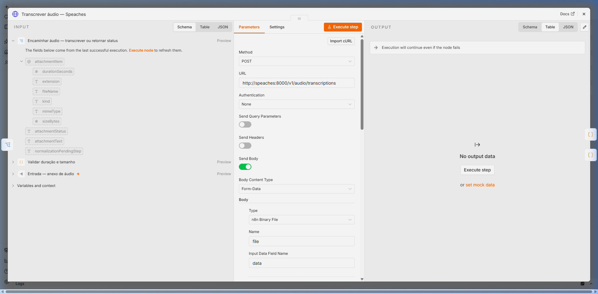
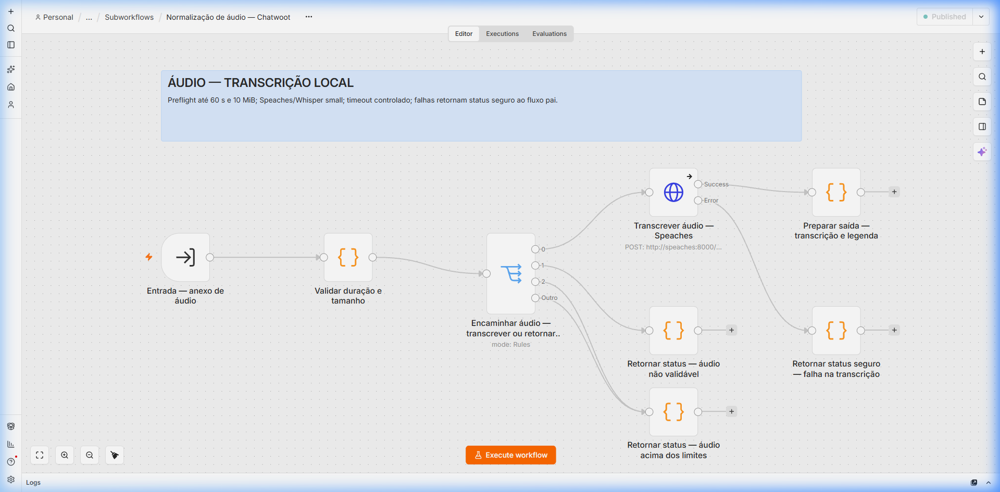

# Guia ilustrado — transcrição de áudio com Speaches

**Projeto:** n8n self-hosted em Docker Compose  
**Serviço STT:** Speaches (faster-whisper)  
**Aceleração:** GPU NVIDIA (CUDA float16)  
**Endpoint interno:** `http://speaches:8000/v1/audio/transcriptions`  
**Workflows atendidos:** `Normalização de áudio — Chatwoot.json` e `Agente RAG Fatec.json`  
**Revisado:** 25/10/2026

> **Sobre os prints:** a imagem abaixo é uma captura da interface do n8n mostrando a esteira de processamento de áudio e a parametrização do nó de transcrição do Speaches em execução.

---

## O que este pipeline faz

O **Speaches** atua como o servidor local de Speech-to-Text (STT) para mensagens de voz enviadas pelo WhatsApp. A esteira multimodal recebe o áudio, valida os limites físicos e aciona a transcrição localmente sem custos de APIs externas ou envio de áudios confidenciais para fora da infraestrutura:

```
WhatsApp (Áudio) ──▶ WAHA ──▶ Chatwoot ──▶ n8n (Validação) ──▶ Speaches (GPU CUDA) ──▶ Texto ──▶ LLM / RAG
```

1. **Recepção**: O WAHA entrega o áudio no Chatwoot, que dispara o webhook para o n8n.
2. **Normalização**: O fluxo identifica o anexo (`audio/ogg`, `audio/opus`, `audio/mp3`, `audio/wav`, etc.).
3. **Filtro de Segurança**: Áudios acima de **60 segundos** ou **10 MiB** são bloqueados preventivamente.
4. **Transcrição em VRAM**: O Speaches processa o áudio em ~1 a 2 segundos via GPU NVIDIA e devolve o texto para o agente conversacional.

---

## 1. Configuração do nó de transcrição no n8n

No subworkflow [`workflows/subworkflows/Normalização de áudio — Chatwoot.json`](https://github.com/Gabriel-Bassani-da-Silva/chatbot/blob/feat/knowledge-base-and-workflows/workflows/subworkflows/Normaliza%C3%A7%C3%A3o%20de%20%C3%A1udio%20%E2%80%94%20Chatwoot.json), o nó **`Transcrever áudio — Speaches`** é configurado como uma chamada HTTP interna:

| Campo no n8n | Valor configurado |
|---|---|
| **Method** | `POST` |
| **URL** | `http://speaches:8000/v1/audio/transcriptions` |
| **Send Body** | Ativado (`true`) |
| **Content Type** | `Multipart/Form-Data` |
| **Campo `file`** | Binário de áudio baixado do Chatwoot |
| **Campo `model`** | `Systran/faster-whisper-small` |
| **Campo `language`**| `pt` |
| **Campo `prompt`**  | `"Transcrição fiel de uma mensagem de voz em português do Brasil, com palavras e letras soletradas."` |



> **Print 1 — Configuração do nó de transcrição no n8n.** Conexão direta via requisição HTTP multipart com o container Speaches na rede interna `speech` (`http://speaches:8000/v1/audio/transcriptions`), repassando o binário de áudio `data` como campo de arquivo `file`.



> **Print 2 — Visão geral da esteira de áudio no canvas do n8n.** Fluxo completo com validação de duração (máx 60 s), tamanho (máx 10 MiB), roteamento condicional e tratamento seguro de falhas de transcrição.

---

## 2. Validação e limites da esteira

O processamento respeita travas para proteger o servidor e a memória da GPU:

| Regra | Limite operacional | Comportamento em caso de violação |
|---|---|---|
| **Duração do áudio** | Máximo de **60 segundos** | O status muda para `unsupported` e o bot orienta o usuário a enviar mensagem mais curta. |
| **Tamanho do arquivo** | Máximo de **10 MiB** | Rejeição automática antes do download para poupar largura de banda. |
| **MIME types permitidos** | `audio/ogg`, `audio/opus`, `audio/mpeg`, `audio/mp3`, `audio/m4a`, `audio/wav`, `audio/aac`, `audio/amr`, `audio/webm` | Formatos de imagem (`image/jpeg`, etc.) ou documento (`application/pdf`) são classificados e não são enviados ao Speaches. |

---

## 3. Gestão de memória VRAM e modelos

- **Gestão de VRAM com TTL de 300 s**: O Speaches mantém o modelo carregado na GPU após a transcrição por 300 segundos (`STT_MODEL_TTL=300`, `WHISPER__TTL=300`). Caso não ocorram novos áudios em 5 minutos, o modelo é descarregado automaticamente da memória de 10 GB da RTX 3080, liberando espaço para o LLM (`llama3.1:latest`) e os embeddings (`qwen3-embedding:0.6b`).
- **Modelo padronizado**: Utiliza o `Systran/faster-whisper-small`, proporcionando alta acurácia na transcrição do português brasileiro com baixo consumo de memória (~1,5 GB VRAM) e latência inferior a 1,5 s.
- **Cache persistente**: O volume `speaches_model_cache` garante que reinicializações do servidor não precisem baixar os pesos do modelo novamente.

---

## 4. Checklist da esteira multimodal

- [ ] Volume `speaches_model_cache` montado para persistência dos pesos.
- [ ] Rede Docker `speech` conectando o container `n8n` ao `speaches`.
- [ ] Nó `Transcrever áudio — Speaches` apontando para `http://speaches:8000/v1/audio/transcriptions`.
- [ ] Limites de 60s e 10 MiB validados pelo nó anterior.
- [ ] Prompt contextualizado em português do Brasil configurado na requisição.

---

## 5. Referências oficiais

- [Repositório oficial Speaches](https://github.com/speaches-ai/speaches)
- [Documentação oficial de configuração do Speaches](https://speaches.ai/configuration/)
- [Documentação de Speech-to-Text do Speaches](https://speaches.ai/usage/speech-to-text/)
- [Repositório faster-whisper (Systran)](https://github.com/SYSTRAN/faster-whisper)
