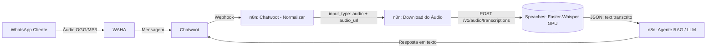

# Resumo das Alterações: Transcrição de Áudio com Speaches (Whisper CUDA)

Este documento reúne todas as alterações de código, infraestrutura e lógica implementadas para adicionar o serviço de transcrição local de áudio ao projeto.

---

## 1. Visão Geral

- **Objetivo**: Habilitar a transcrição automática de mensagens de voz enviadas pelo WhatsApp (via Chatwoot) diretamente para o n8n.
- **Motor de Transcrição**: [Speaches](https://github.com/speaches-ai/speaches) com backend `faster-whisper` (CTranslate2).
- **Aceleração por Hardware**: GPU dedicada NVIDIA GeForce RTX 3080 (10 GB VRAM) usando CUDA 12.6 e precisão `float16`.
- **Desempenho Estimado**: ~400ms a 800ms por áudio de 30 segundos (totalmente offline e sem custos de API).
- **API Exposta**: Compatível com o padrão OpenAI (`/v1/audio/transcriptions`).

---

## 2. Diagrama de Fluxo



---

## 3. Resumo dos Arquivos Modificados

| Arquivo | Tipo de Alteração | Descrição |
| :--- | :--- | :--- |
| [`versions.env`](../versions.env) | Configuração | Fixada a versão da imagem do Speaches (`latest-cuda-12.6.3`). |
| [`compose.yml`](../compose.yml) | Infraestrutura | Adicionados o serviço `speaches`, volume `speaches_model_cache` e rede `speech`. |
| [`nodes/chatwoot_normalizer.js`](../nodes/chatwoot_normalizer.js) | Lógica da Aplicação | Suporte a anexos de áudio no webhook do Chatwoot. |
| [`tests/test_chatwoot_normalizer.py`](../tests/test_chatwoot_normalizer.py) | Testes Unitários | Testes para validação de áudio e descarte de mensagens inválidas. |

---

## 4. Detalhamento das Alterações de Código

### 4.1. `versions.env`
Centralização da versão da imagem Docker:

```diff
 CHATWOOT_VERSION=v4.18.0-ce
+SPEACHES_VERSION=latest-cuda-12.6.3
```

---

### 4.2. `compose.yml`

#### A. Novo Volume Persistente para Modelos
Evita baixar o modelo HuggingFace a cada reinicialização dos containers:
```diff
 volumes:
   n8n_data:
   pgdata:
   redis_data:
   waha_sessions:
   waha_media:
   caddy_data:
   caddy_config:
   chatwoot_storage:
+  speaches_model_cache:
```

#### B. Nova Rede Interna
Rede dedicada e isolada para comunicação rápida entre n8n e Speaches:
```diff
 networks:
   edge:
   backend:
   waha_apps:
     internal: true
+  speech:
```

#### C. Conexão do `n8n` à Rede de Transcrição
```diff
   n8n:
     networks:
       - edge
       - backend
+      - speech
```

#### D. Novo Serviço `speaches`
```yaml
  # Transcrição local de áudio via faster-whisper/Speaches.
  speaches:
    image: ghcr.io/speaches-ai/speaches:${SPEACHES_VERSION:?SPEACHES_VERSION is required}
    restart: unless-stopped
    ports:
      # API local para administração/testes; não fica exposta à rede externa.
      - "127.0.0.1:8000:8000"
    volumes:
      - speaches_model_cache:/home/ubuntu/.cache/huggingface/hub
    environment:
      - WHISPER__INFERENCE_DEVICE=cuda
      - WHISPER__COMPUTE_TYPE=float16
      # Documentação oficial: STT_MODEL_TTL=-1 mantém o modelo de transcrição na VRAM.
      # WHISPER__TTL=-1 mantido para compatibilidade retroativa com versões anteriores:
      - STT_MODEL_TTL=-1
      - WHISPER__TTL=-1
      # PRELOAD_MODELS: Opcional. O Speaches encerra a inicialização (exit) se o modelo falhar
      # ao baixar ou se houver oscilação de rede no boot. Mantido comentado por resiliência:
      # - PRELOAD_MODELS='["Systran/faster-whisper-medium"]'
    healthcheck:
      test: ["CMD-SHELL", "python3 -c \"import urllib.request; urllib.request.urlopen('http://localhost:8000/health')\""]
      interval: 30s
      timeout: 10s
      retries: 3
      start_period: 30s
    networks:
      - speech
    deploy:
      resources:
        reservations:
          devices:
            - driver: nvidia
              count: all
              capabilities: [gpu]
    <<: *default-logging
```

---

### 4.3. `nodes/chatwoot_normalizer.js`
Quando o usuário envia um áudio no WhatsApp, o Chatwoot envia `content: ""` e os dados do arquivo na lista `attachments`. O normalizador foi ajustado para aceitar mensagens com áudio válido mesmo sem texto:

```diff
 const sender = message.sender ?? body.sender ?? {};
 const senderId = String(sender.id ?? '');
 const isPrivate = Boolean(message.private ?? body.private ?? false);
 
+const attachments = Array.isArray(message.attachments)
+    ? message.attachments
+    : (Array.isArray(body.attachments) ? body.attachments : []);
+
+const firstAttachment = attachments[0] || {};
+const fileType = String(firstAttachment.file_type || '').toLowerCase();
+const contentType = String(firstAttachment.content_type || '').toLowerCase();
+const isAudio = fileType === 'audio' || contentType.startsWith('audio/');
+const audioUrl = isAudio ? String(firstAttachment.data_url || '') : '';
+
+const hasContent = Boolean(content.trim());
+const hasValidAudio = isAudio && Boolean(audioUrl);
+
 const valid =
     event === 'message_created' &&
     messageType === 'incoming' &&
     !isPrivate &&
-    content.trim() &&
+    (hasContent || hasValidAudio) &&
     conversationId &&
     messageId;
 
 if (!valid) {
     return {
         json: {
             process: false,
             chatwoot_event: event,
             message_id: messageId
         }
     };
 }
 
+const inputType = hasValidAudio ? 'audio' : 'text';
+
 return {
     json: {
         process: true,
         source: 'chatwoot',
         channel: 'chatwoot',
-        chatInput: content,
-        text: content,
-        caption: content,
-        input_type: 'text',
+        chatInput: hasContent ? content : '',
+        text: hasContent ? content : '',
+        caption: hasContent ? content : '',
+        input_type: inputType,
+        audio_url: audioUrl,
+        file_type: fileType,
         session_id: 'chatwoot:' + conversationId,
         conversation_id: conversationId,
         user_id: senderId || 'conversation:' + conversationId,
```

---

### 4.4. `tests/test_chatwoot_normalizer.py`
Adicionados dois novos testes unitários para garantir a cobertura da nova lógica:
1. `test_incoming_audio_attachment_is_normalized`: garante que mensagens com anexo de áudio e sem texto são processadas (`process = true`, `input_type = 'audio'`).
2. `test_message_without_content_or_audio_is_ignored`: garante que mensagens vazias sem anexo válido continuam sendo descartadas (`process = false`).

---

## 5. Como Usar no n8n

### Passo 1: Download do Áudio
No n8n, filtre as mensagens com `input_type === 'audio'`. Adicione um nó **HTTP Request**:
- **Method**: `GET`
- **URL**: `={{ $json.audio_url }}`
- **Response Format**: `File` (Binary)
- **Put Output in Field**: `data`

### Passo 2: Transcrição via Speaches
Adicione um nó **HTTP Request** ou nó **OpenAI (Transcribe an audio file)**:

**Via HTTP Request (Recomendado por simplicidade):**
- **Method**: `POST`
- **URL**: `http://speaches:8000/v1/audio/transcriptions`
- **Send Body**: `true`
- **Body Content Type**: `Multipart Form Data`
- **Form Data**:
  - `file`: Tipo *Binary*, nome do campo `data`
  - `model`: Tipo *String*, valor `Systran/faster-whisper-medium`
  - `language`: Tipo *String*, valor `pt`
- **Retorno**:
  ```json
  {
    "text": "Olá, gostaria de informações sobre os cursos da Fatec."
  }
  ```

### Passo 3: Injeção no Agente
Substitua o campo `chatInput` / `text` pelo campo `$json.text` retornado pelo Speaches e conecte diretamente à entrada do seu fluxo RAG / Ollama existente.
