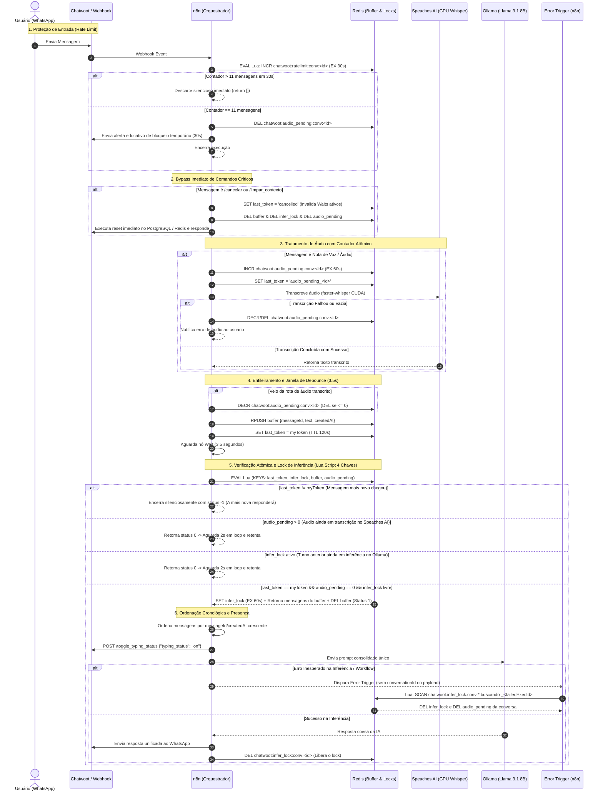

# Arquitetura de Tratamento de Mensagens Concorrentes, Spam e Agrupamento no WhatsApp

> **Projeto de TCC:** Assistente Virtual Multimodal — Fatec Bebedouro  
> **Autor:** Gabriel Bassani da Silva (Tecnologia em Big Data no Agronegócio)  
> **Data:** Outubro de 2026  
> **Escopo:** WAHA + Chatwoot + n8n + Redis + Speaches AI (faster-whisper) + Ollama (Llama 3.1 8B)

---

## 1. Contextualização e Motivação do Problema

No canal WhatsApp, o comportamento natural de digitação humana é fragmentado. Em vez de formular um parágrafo único e estruturado, o usuário comumente envia **múltiplas mensagens curtas em rajada** (intervalo de 1 a 4 segundos):

```text
[18:10:01] Aluno: Oi
[18:10:02] Aluno: Tudo bem?
[18:10:04] Aluno: Quero saber sobre vestibular
[18:10:06] Aluno: e quais cursos tem
```

### O Desafio na Arquitetura de Eventos Assíncronos
Cada mensagem recebida pelo gateway WAHA gera um evento webhook individual no Chatwoot, que por sua vez aciona o webhook do n8n (`Webhook Chatwoot RAG`). 

Sem uma camada de mediação temporal e controle de concorrência:
1. **Disparo Concorrente de Execuções:** O n8n inicia 4 execuções paralelas do workflow quase simultaneamente.
2. **Degradação de VRAM na GPU Local:** Múltiplas instâncias concorrem pela GPU NVIDIA para carregar e inferir no modelo local Llama 3.1 8B via Ollama, gerando gargalo de latência ou estouro de memória (OOM).
3. **Condições de Corrida de Memória (Race Conditions):** Instâncias concorrentes leem e escrevem no histórico da conversa no Redis e no PostgreSQL (`fatec_conversation_state`) simultaneamente, gerando inconsistência de sessão.
4. **Experiência do Usuário Degradada ("Robô Metralhadora"):** O bot responde individualmente a cada fragmento com mensagens truncadas e fora de ordem.

---

## 2. Matriz de Classificação de Tráfego

Para que o sistema seja robusto e seguro, é necessário categorizar o tráfego em três classes distintas, aplicando a estratégia adequada para cada uma:

| Dimensão | 1. Burst Humano Legítimo | 2. Flooding / Spam Malicioso | 3. Mensagem em Inferência Ativa |
| :--- | :--- | :--- | :--- |
| **Comportamento** | 2 a 5 mensagens em intervalo de 2 a 5s. Ex: *"Oi"* $\rightarrow$ *"Tudo bem?"* $\rightarrow$ *"Quero saber dos cursos"*. | 15 a 50+ mensagens por segundo (loops de clientes, scripts ou cliques repetitivos). | O usuário envia uma nova mensagem enquanto o Llama 3.1 ainda está gerando a resposta do turno anterior (janela de 5 a 12s). |
| **Intenção** | Legítima (digitação natural humana em etapas). | Abusiva ou acidental (risco de DoS no n8n e na GPU). | Legítima (complemento ou dúvida adicional enquanto aguarda). |
| **Mecanismo Aplicado** | **Debounce Buffer com Eleição de Guardião:** Enfileira no Redis e consolida em 3,5s. | **Rate Limit Atômico Pré-Wait:** Bloqueio temporário (30s) na 11ª mensagem e descarte silencioso (`return []`). | **Lock Atômico de Inferência (`infer_lock`):** Mantém o novo turno no buffer e aguarda a inferência anterior terminar. |
| **Resultado** | **1 única resposta integrada e coesa**, respondendo saudação e perguntas juntas. | Alerta educativo único de proteção e proteção da memória do n8n (zero alocação de nós `Wait`). | A resposta anterior é entregue e o novo turno consolidado é processado sequencialmente. |

---

## 3. Diagrama Geral da Arquitetura Distribuída

O diagrama abaixo ilustra o ciclo de vida completo de uma mensagem concorrente, incluindo a proteção contra spam, o tratamento prioritário de comandos, o pré-lock atômico com contador de áudio pendente (`audio_pending`), a consolidação atômica de 4 chaves e o desbloqueio por `execution.id` no `Error Trigger`:



---

## 4. Detalhamento Técnico das Etapas e Eliminação de Race Conditions

### 4.1 Prevenção de Rate Limit / Spam Pré-Wait
Para evitar que ataques de flooding ou disparos em loop esgotem a memória do n8n com milhares de timers de nós `Wait`, o controle é executado **antes** de qualquer agendamento de espera:

```javascript
// Nó: Redis — Rate Limit Check
const Redis = require('ioredis');
const redis = new Redis('redis://:f81a34c353b25e714182ab9345737beec9630d4380d9c6106f34c1afa33a6f8c@redis:6379/0');

try {
  const convId = String($json.conversationId);
  const rlKey = `chatwoot:ratelimit:conv:${convId}`;

  // Incremento atômico com expiração na primeira criação
  const count = await redis.eval(`
    local c = redis.call('INCR', KEYS[1])
    if c == 1 then
      redis.call('EXPIRE', KEYS[1], 30)
    end
    return c
  `, 1, rlKey);

  await redis.quit();

  if (count > 11) {
    // Da 12ª em diante: descarte silencioso sem alocar nó Wait
    return [];
  }

  return {
    json: {
      ...$json,
      rateLimitCount: count,
      isRateLimited: count === 11
    }
  };
} catch (e) {
  try { await redis.quit(); } catch {}
  return { json: { ...$json, rateLimitCount: 1, isRateLimited: false } };
}
```

### 4.2 Bypass Imediato de Comandos Críticos (`/cancelar` e `/limpar_contexto`)
Comandos de controle não podem aguardar a janela de debounce. Além disso, devem abortar qualquer execução adormecida e limpar buffers e locks:

```javascript
// Nó: Redis — Resetar Locks e Invalidar Buffer
const Redis = require('ioredis');
const redis = new Redis('redis://:f81a34c353b25e714182ab9345737beec9630d4380d9c6106f34c1afa33a6f8c@redis:6379/0');

try {
  const convId = String($json.conversationId);
  await redis.pipeline()
    .set(`chatwoot:last_token:conv:${convId}`, 'cancelled', 'EX', 30)
    .del(`chatwoot:buffer:conv:${convId}`)
    .del(`chatwoot:infer_lock:conv:${convId}`)
    .del(`chatwoot:audio_pending:conv:${convId}`)
    .exec();
  await redis.quit();
} catch (e) {
  try { await redis.quit(); } catch {}
}

return { json: $json };
```

### 4.3 Tratamento de Áudio com Contador Atômico (`audio_pending`)
Para notas de voz (que levam de 2s a 5s para transcrição CUDA no Speaches AI), o sistema utiliza um **contador atômico dedicado** `chatwoot:audio_pending:conv:<id>`:

1. **Antes de chamar o Speaches AI (`Redis — Marcar Áudio Pendente`):**
   ```javascript
   await redis.pipeline()
     .incr(`chatwoot:audio_pending:conv:${convId}`)
     .expire(`chatwoot:audio_pending:conv:${convId}`, 60)
     .set(`chatwoot:last_token:conv:${convId}`, `audio_pending_${msgId}_${execId}`, 'EX', 60)
     .exec();
   ```
   Propaga no item `{ ...$json, isAudioPendingIncremented: true }`.

2. **Ao concluir a transcrição e entrar no Buffer (`Redis — Salvar Mensagem no Buffer`):**
   O contador é decrementado atomicamente. Caso atinja zero ou menos, a chave é deletada:
   ```javascript
   if ($json.isAudioPendingIncremented || $json.inputType === 'audio') {
     const count = await redis.decr(`chatwoot:audio_pending:conv:${convId}`);
     if (count <= 0) {
       await redis.del(`chatwoot:audio_pending:conv:${convId}`);
     }
   }
   ```
   *Segurança Adicional:* Em caso de falha ou áudio vazio (`Redis — Limpar Áudio Pendente no Erro`), o contador também é decrementado/limpo para nunca reter a conversa indefinidamente.

### 4.4 Consolidação Atômica e Lock de Inferência (Script Lua de 4 Chaves)
Após os 3,5s do nó `Wait`, a verificação de token, contagem de mídias pendentes, lock de inferência, extração do buffer e deleção ocorrem em **uma única transação atômica indivisível** no motor C do Redis:

```lua
-- KEYS[1]: chatwoot:last_token:conv:<convId>
-- KEYS[2]: chatwoot:infer_lock:conv:<convId>
-- KEYS[3]: chatwoot:buffer:conv:<convId>
-- KEYS[4]: chatwoot:audio_pending:conv:<convId>
-- ARGV[1]: myToken (${messageId}_${$execution.id})

local last_token = redis.call('GET', KEYS[1])
if last_token ~= ARGV[1] then
  return { -1, {} } -- Mensagem mais nova assumiu o controle (descarte silencioso)
end

local audio_pending = tonumber(redis.call('GET', KEYS[4]) or '0')
if audio_pending and audio_pending > 0 then
  return { 0, {} }  -- Áudio ainda em transcrição no Speaches AI (aguarda no loop de 2s)
end

local lock = redis.call('GET', KEYS[2])
if lock and lock ~= '' then
  return { 0, {} }  -- Inferência anterior ativa no Ollama (aguarda no loop de 2s)
end

-- Adquire lock com TTL de segurança de 60s
redis.call('SET', KEYS[2], ARGV[1], 'EX', 60)

-- Extrai mensagens e consome buffer atomicamente
local msgs = redis.call('LRANGE', KEYS[3], 0, -1)
redis.call('DEL', KEYS[3])

return { 1, msgs }  -- Sucesso total na consolidação
```

### 4.5 Ordenação Cronológica e Presença Visual (`typing_on`)
As mensagens acumuladas no buffer são ordenadas pelo identificador sequencial `messageId` e timestamp `createdAt`:

```javascript
messages.sort((a, b) => (Number(a.messageId) - Number(b.messageId)) || (Number(a.createdAt) - Number(b.createdAt)));
const combinedText = messages.map(m => String(m.text || '').trim()).filter(Boolean).join('\n');
```

Antes de disparar a inferência no Llama 3.1 8B, o n8n envia a sinalização de digitação ao Chatwoot:
- **Endpoint:** `POST /api/v1/accounts/1/conversations/{conversation_id}/toggle_typing_status`
- **Payload:** `{"typing_status": "on"}`

Ao entregar a resposta no WhatsApp, o lock de inferência é removido:
```javascript
await redis.del(`chatwoot:infer_lock:conv:${conversationId}`);
```

### 4.6 Desbloqueio Resiliente no `Error Trigger` por `execution.id`
No n8n, quando um erro não tratado dispara o nó `Error Trigger`, o payload gerado contém metadados da execução (`$json.execution.id`, `$json.execution.error`), mas **não contém as variáveis de contexto dos nós anteriores (como `$json.conversationId`)**. 

Para evitar que falhas imprevistas deixem conversas travadas pelo TTL de 60s, o nó `Redis — Liberar Lock no Erro` utiliza o `failedExecId` gravado como sufixo do valor do lock (`${messageId}_${executionId}`) para localizar e purgar atômica e precisamente os recursos da conversa afetada:

```javascript
// Nó: Redis — Liberar Lock no Erro
const failedExecId = String($json.execution?.id || '');
const targetConvId = String($json.conversationId || '');

const luaUnlock = `
  local failed_exec_id = ARGV[1]
  local target_conv_id = ARGV[2]
  local cleaned_keys = {}

  if target_conv_id and target_conv_id ~= '' then
    local lock_key = 'chatwoot:infer_lock:conv:' .. target_conv_id
    local val = redis.call('GET', lock_key)
    if val then
      redis.call('DEL', lock_key)
      table.insert(cleaned_keys, lock_key)
    end
    local ap_key = 'chatwoot:audio_pending:conv:' .. target_conv_id
    redis.call('DEL', ap_key)
    table.insert(cleaned_keys, ap_key)
  end

  if failed_exec_id and failed_exec_id ~= '' then
    local pattern = 'chatwoot:infer_lock:conv:*'
    local keys = redis.call('KEYS', pattern)
    for _, key in ipairs(keys) do
      local val = redis.call('GET', key)
      if val and string.find(val, '_' .. failed_exec_id .. '$') then
        redis.call('DEL', key)
        table.insert(cleaned_keys, key)
        local cid = string.match(key, 'chatwoot:infer_lock:conv:(.+)')
        if cid then
          local ap_key = 'chatwoot:audio_pending:conv:' .. cid
          redis.call('DEL', ap_key)
          table.insert(cleaned_keys, ap_key)
        end
      end
    end
  end

  return cleaned_keys
`;

const cleanedKeys = await redis.eval(luaUnlock, 0, failedExecId, targetConvId);
```

---

## 5. Matriz de Resolução de Falhas de Concorrência

| Falha Identificada na Versão Anterior | Causa Raiz | Solução na Arquitetura V2 (Blindada) |
| :--- | :--- | :--- |
| **Race condition entre `LRANGE` e `DEL`** | Se um novo webhook chegasse entre a leitura e o delete, mensagens eram perdidas. | Operação atômica via **Script Lua (`EVAL`)**: a extração do array e o `DEL` acontecem indivisivelmente. |
| **Clock Drift em `Date.now()`** | Empates de milissegundos ou desvios de clock entre instâncias causavam falsos positivos. | Substituição por **Tokens Unívocos** baseados em `messageId` e `executionId`. |
| **Atropelamento por Áudio Longo vs Texto Rápido** | Transcrição no Speaches AI (3-6s) era atropelada pelo `Wait` de 3,5s de um texto curto enviado logo em seguida (*"escuta aí"*). | **Contador Atômico `audio_pending`**: retém textos no loop com status `0` enquanto o áudio estiver na GPU, consolidando ambos na ordem cronológica exata. |
| **Perda de Contexto no `Error Trigger`** | O nó de erro do n8n não preserva `$json.conversationId`, tentando deletar `conv:undefined` e travando a conversa por 60s. | **Desbloqueio por `execution.id`**: Varredura atômica via Lua de chaves que terminam com `_${failedExecId}`, liberando `infer_lock` e `audio_pending`. |
| **Sobrecarga de nós `Wait` em Spam** | Ataques de spam criavam milhares de timers `Wait` em memória no n8n. | **Rate Limit Atômico Pré-Wait**: a 11ª mensagem avisa e da 12ª em diante é descartada imediatamente (`return []`). |
| **Concorrência em Inferência Ativa** | Usuário enviava nova mensagem enquanto o Llama 3.1 ainda gerava o turno anterior. | **Lock Atômico de Inferência (`infer_lock`)**: o novo turno aguarda 2s em loop e só inicia quando o Ollama libera. |

---

## 6. Conclusão e Relevância para o TCC

A arquitetura refatorada transforma o Assistente Virtual da Fatec Bebedouro em um sistema distribuído de mensageria com padrão corporativo:
- **Eficiência de Recursos:** Redução drástica do consumo de VRAM na GPU local, agrupando turnos fragmentados em inferências consolidadas.
- **Soberania e Privacidade:** Toda a fila, controle de estado e inteligência rodam em containers locais no Docker Compose.
- **Robustez e UX:** O aluno recebe atendimento fluido, com indicador de digitação em tempo real, sem respostas duplicadas ou fora de ordem.
- **Resiliência Distribuída:** Blindagem completa contra condições de corrida multimodais (voz vs texto) e auto-recuperação garantida em falhas.

